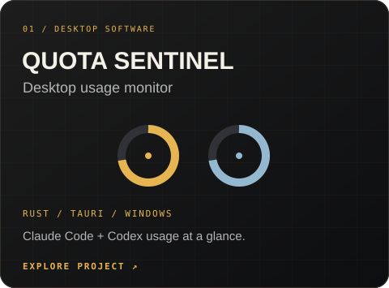
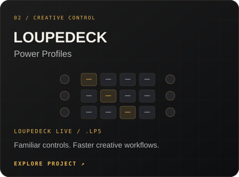

<picture>
  <source media="(max-width: 640px)" srcset="assets/header-mobile.svg" />
  
</picture>

  
  

## Behind the builds

I'm the creator behind **GrizzlyFX**. I build practical tools that reduce friction in creative and everyday workflows — from desktop software to controls that make familiar applications easier to use.

My focus is simple: clear interfaces, useful automation and more time for the work that matters.

## Selected projects

<table>
  <tr>
    <td width="50%" valign="top">
      
      
An experimental Windows dock that keeps Claude Code and OpenAI Codex usage and reset times within reach.

      
<a href="https://github.com/solo19978/quota-sentinel">Source &amp; documentation</a> · <a href="https://github.com/solo19978/quota-sentinel/releases">Releases</a>

    </td>
    <td width="50%" valign="top">
      
      
A growing collection of Loupedeck Live profiles with consistent layouts, useful dial mappings and application-specific controls.

      
<a href="https://github.com/solo19978/loupedeck-power-profiles">Explore the collection</a> · <a href="https://github.com/solo19978/loupedeck-power-profiles#profiles-available-now">Download profiles</a>

    </td>
  </tr>
</table>

## Public build activity

<a href="https://github.com/solo19978?tab=overview">
<picture>
  <source media="(max-width: 640px)" srcset="assets/activity-mobile.svg" />
  
</picture>
</a>

<strong>What these numbers measure</strong>

The panel uses public GitHub data and refreshes daily. It counts owned, non-fork public projects, excluding this profile repository. Commit counts cover the last 84 UTC dates and use default-branch commits GitHub attributes to `solo19978`.

These are public project metrics, so they may differ from GitHub's contribution calendar. Private work is excluded. If a refresh fails, the previous snapshot remains visible with its original date.

[View the public data](assets/public-activity.json) · [View refresh runs](https://github.com/solo19978/solo19978/actions/workflows/refresh-profile.yml)

## Tools &amp; workflows

| Area | What I work with |
| --- | --- |
| Desktop software | Rust, Tauri, Windows, HTML, CSS and JavaScript |
| Workflow control | Loupedeck Live profiles, shortcuts, macros and dial mappings |
| Creative applications | DaVinci Resolve, Blender and Samplitude |
| Everyday tools | Visual Studio Code, Chrome and Spotify |

## From friction to a useful tool

- Start with a problem I encounter in real work.
- Keep controls familiar and interfaces easy to follow.
- Document the setup, limitations and changes.
- Improve the tool as the workflow evolves.

---

  <strong>GRIZZLYFX</strong> 
  Practical tools. Creative freedom.

