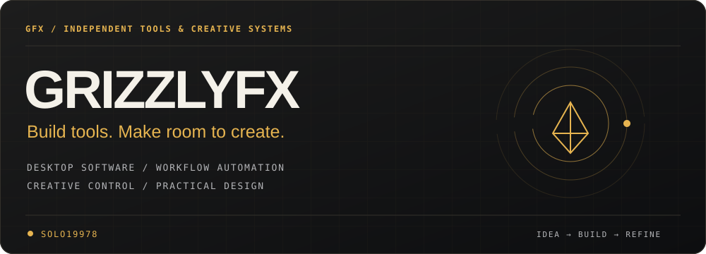
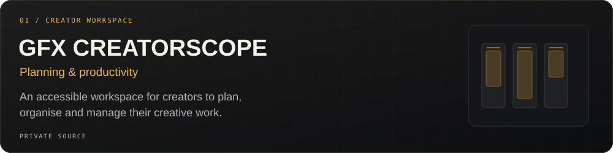
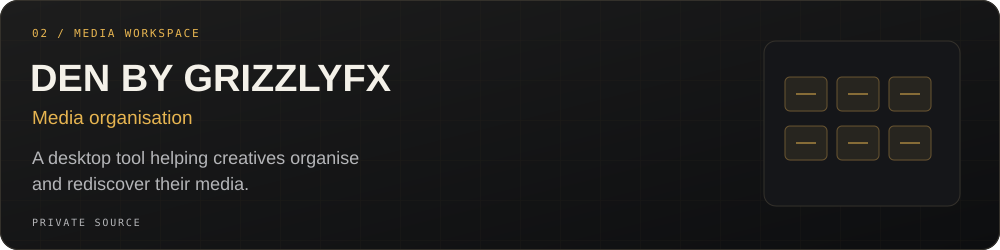
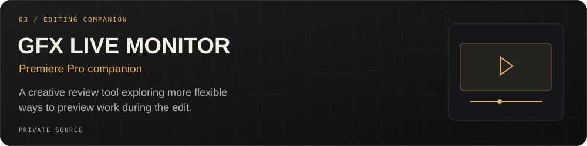
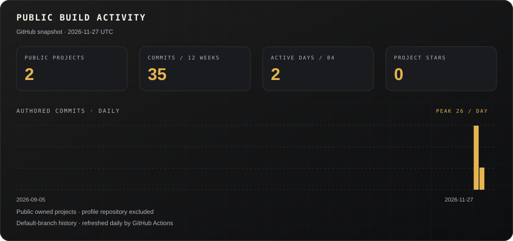
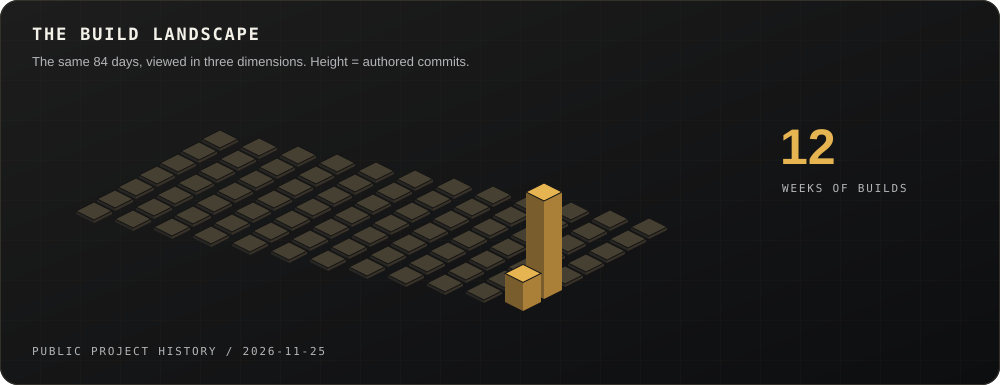
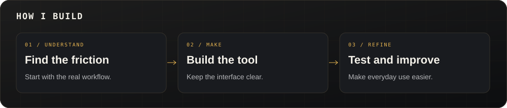

<picture>
  <source media="(max-width: 640px)" srcset="assets/header-mobile.svg" />
  
</picture>

  
  

## Behind the builds

I'm the creator behind **GrizzlyFX**. My main work is software for creators: helping people plan their work, organise their media and improve the editing experience.

My focus is simple: clear interfaces, useful automation and more time for the work that matters.

## Flagship projects

My larger products span creator productivity, media organisation and editing workflows. Their source repositories remain private.

<picture>
  <source media="(max-width: 640px)" srcset="assets/flagship-creatorscope-mobile.svg" />
  
</picture>

<picture>
  <source media="(max-width: 640px)" srcset="assets/flagship-den-mobile.svg" />
  
</picture>

<picture>
  <source media="(max-width: 640px)" srcset="assets/flagship-premiere-mobile.svg" />
  
</picture>

## Public tools

Alongside the flagship products, I share smaller tools and workflow resources:

| Tool | Purpose |
| --- | --- |
| [Quota Sentinel](https://github.com/solo19978/quota-sentinel) | An experimental Windows dock for Claude Code and OpenAI Codex usage and reset times. |
| [Loupedeck Power Profiles](https://github.com/solo19978/loupedeck-power-profiles) | Ready-to-use Loupedeck Live profiles with familiar layouts and useful application controls. |

## Public build activity

This snapshot covers the public tools below the flagship products; it is not a measure of development in the private repositories.

<strong>View public activity statistics and build landscape</strong>

<a href="https://github.com/solo19978?tab=overview">
<picture>
  <source media="(max-width: 640px)" srcset="assets/activity-mobile.svg" />
  
</picture>
</a>

<strong>What these numbers measure</strong>

The panel uses public GitHub data and refreshes daily. It counts owned, non-fork public projects, excluding this profile repository. Commit counts cover the last 84 UTC dates and use default-branch commits GitHub attributes to `solo19978`.

These are public project metrics, so they may differ from GitHub's contribution calendar. Private work is excluded. If a refresh fails, the previous snapshot remains visible with its original date.

[View the public data](assets/public-activity.json) · [View refresh runs](https://github.com/solo19978/solo19978/actions/workflows/refresh-profile.yml)

## Tools &amp; workflows

| Area | What I work with |
| --- | --- |
| Creator software | Accessible interfaces, planning tools, media organisation and editing workflows |
| Desktop software | Rust, Tauri, Windows, HTML, CSS and JavaScript |
| Workflow control | Loupedeck Live profiles, shortcuts, macros and dial mappings |
| Creative applications | DaVinci Resolve, Blender and Samplitude |
| Everyday tools | Visual Studio Code, Chrome and Spotify |

## From friction to a useful tool

- Start with a problem I encounter in real work.
- Keep controls familiar and interfaces easy to follow.
- Document the setup, limitations and changes.
- Improve the tool as the workflow evolves.

---

  <strong>GRIZZLYFX</strong> 
  Practical tools. Creative freedom.

